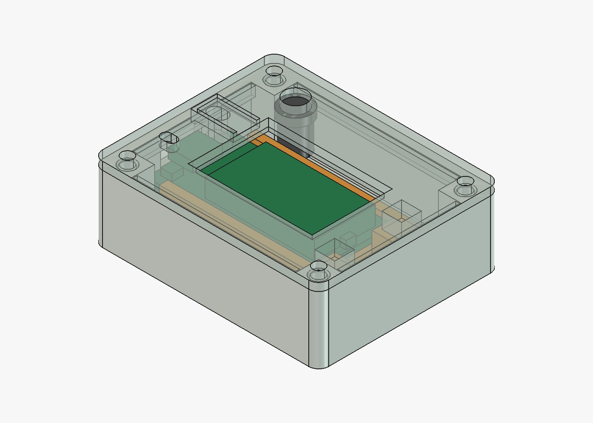

# Receiver enclosure: Heltec WiFi LoRa 32 V3

English | [Português brasileiro](README.pt-BR.md)

**Current revision: `r01` (tag `heltec-wifi-lora-32-v3/receiver/r01`), physical test
pending.**

Enclosure for a receiver built on the Heltec WiFi LoRa 32 V3, powered through its USB-C
and installed indoors on a shelf, like a modem. The board lies flat with the OLED facing
up under a window in the lid, the USB-C cable leaves through the back wall and the antenna
stands up from the lid at the back corner. There is no battery. The header pins must be
removed from the board. Nothing is sealed: indoor use only.



## Parts

| File | Part | On the bed |
| --- | --- | --- |
| [`body.stl`](print/body.stl) | Body, with columns and floor pins | Base on the bed |
| [`lid.stl`](print/lid.stl) | Lid with the OLED window, the PRG tab, the RST pinhole, the SMA hole, an alignment lip and 2 posts that hold the carrier | Outer face on the bed (already flipped) |
| [`board-carrier.stl`](print/board-carrier.stl) | WiFi LoRa 32 V3 carrier with rails on a 5 mm base | Crossbars on the bed |

The three files come oriented for printing and need no supports. Suggested settings: PETG,
0.2 mm layers, 4 walls, 100% scale. PETG is preferred over PLA for the flexible PRG tab.
The SHA-256 of each file is in [`revision.json`](revision.json).

## Hardware

- **Board.** One Heltec WiFi LoRa 32 V3 with the header pins removed. For the receiver
  firmware (`runtime_rx`), see the
  [radio applications guide](https://github.com/cajui/cajui-firmware/blob/main/docs/radio-applications.md).
- **Inserts.** 4 M3 heat-set inserts, at the top of the body columns. The holes are Ø4.0 ×
  6.5 mm, with a chamfer to Ø5.0 mm at the mouth, sized for an M3 insert 5.7 mm long and
  Ø4.6 mm outside. Use an insert of Ø4.2 to 4.6 mm outside and up to 6 mm long.
- **Screws.** 4 M3×8 screws for the lid. The board carrier uses no screws.
- **Antenna.** 1 bulkhead SMA connector in the 6.8 mm hole of the lid, with an IPEX 1.0
  pigtail of at least 90 mm, to reach from the antenna end of the board to the back corner
  (the kit pigtail is 130 mm).
- **Power.** A USB-C cable through the back opening, 12.5 × 7 mm.

## Layout

Outer size 68.8 × 55.3 × 22.8 mm. Inside, from the -Y wall: a 7.5 mm band for the back
columns, the carrier with the board, then a 13 mm band for the pigtail and the SMA
connector. The board is raised on the carrier base so the OLED glass sits 1 mm under the
lid while the SMA band keeps its full height for the connector body and the bend of the
pigtail.

On the lid, over the USB end of the board: RST through a 3 mm pinhole (press with a
toothpick) and PRG through a 12 × 6 mm tab cut by a U-shaped slot, 1 mm thick, with a 4 mm
nub underneath that stops 0.3 mm above the switch. Pressing the tab presses PRG. Pinhole
and nub are slots stretched 1.76 mm along the board: the model uses the datasheet length
of 50.2 mm, and an earlier caliper reading gave 51.96 mm.

## Assembly

1. **Inserts.** Set them upright with a soldering iron: rest the insert on the chamfer,
   let the heat do the work, check it is straight during the first millimetre, stop just
   short of the top and press it flush with a flat piece of metal.
2. **Pigtail.** Plug the IPEX end onto the board connector before the board goes into the
   carrier.
3. **Board.** Slide it into the rails from the USB end, OLED up, holding it by the edges,
   until it touches the heads. The pigtail leaves between the heads.
4. **Carrier.** Place it in the body with the USB-C facing the back opening and drop the
   heads onto the two floor pins.
5. **Antenna.** Fit the SMA bulkhead in the lid hole with its nut. Route the pigtail along
   the +Y band, away from the columns.
6. **Lid.** Close with the four M3 screws; the posts land on the carrier heads.

## What to check on the first print

Print the carrier and the lid first: with the board in the carrier and the lid resting on
the heads, every opening can be checked against the board before printing the body.

- The board slides into the rails without force, up to the heads, and the solder left in
  the header holes does not catch on the lips.
- The OLED glass is centred in the window and not touching the lid.
- The RST pinhole is over the RST switch, and the PRG nub lands on the PRG switch dome: a
  press on the tab opens the configuration portal after 3 s.
- The board stops at the heads with the USB-C about 0.5 mm from the carrier's back end,
  and the cable plugs in fully through the opening. The model uses the datasheet length of
  50.2 mm; if the USB-C stands out further, the board is the 51.96 mm one.
- The SMA connector threads into the 2.4 mm lid, its body clears the carrier, and the
  pigtail reaches the back corner without a tight bend.
- The heads go onto the pins without force, and the lid closes without pushing the
  carrier down.
- The inserts sit centred: the screws pass through the lid without force.

## Revision history

- **r01 (2026-11-11).** First layout. Untested.

## Regenerate

From the repository root:

```sh
# STLs in print/ and verification.json
freecadcmd enclosures/heltec-wifi-lora-32-v3/receiver/export.py
# print/preview.png; needs the FreeCAD GUI
FreeCAD enclosures/heltec-wifi-lora-32-v3/receiver/render.py
```

On macOS, the two programs are `/Applications/FreeCAD.app/Contents/Resources/bin/freecadcmd`
and `/Applications/FreeCAD.app/Contents/MacOS/FreeCAD`. Tested with FreeCAD 1.1.4.

- **Model.** The parametric model is [`model.py`](model.py), with every dimension in the `P`
  dictionary.
- **Checks.** [`verification.json`](verification.json) records the mesh checks and the
  assembly collision check.
- **Revision.** [`revision.json`](revision.json) holds the revision, the hashes and the known
  limits.
