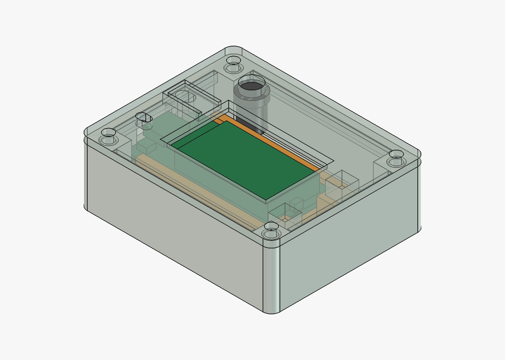

# Caixa da receptora: Heltec WiFi LoRa 32 V3

[English](README.md) | Português brasileiro

**Revisão atual: `r02` (tag `heltec-wifi-lora-32-v3/receiver/r02`). Todas as peças
impressas e montadas com a placa; funcionamento relatado.**

Caixa para uma receptora montada na Heltec WiFi LoRa 32 V3, alimentada pelo USB-C e
instalada dentro de casa, apoiada numa prateleira, como um modem. A placa fica deitada
com o OLED para cima, sob uma janela na tampa; o cabo USB-C sai pela parede de trás e a
antena fica em pé na tampa, no canto de trás. Não há bateria. Os pinos da placa precisam
ser retirados. Nada é vedado: uso só em ambiente interno.



## Peças

| Arquivo | Peça | Na mesa |
| --- | --- | --- |
| [`body.stl`](print/body.stl) | Corpo, com colunas e pinos do piso | Base na mesa |
| [`lid.stl`](print/lid.stl) | Tampa com a janela do OLED, a aba do PRG, o furo do RST, o furo do SMA, lábio de alinhamento e 2 postes que seguram o suporte | Face externa na mesa (já virada) |
| [`board-carrier.stl`](print/board-carrier.stl) | Suporte da WiFi LoRa 32 V3 com trilhos sobre uma base de 5 mm | Travessas na mesa |

Os três arquivos já vêm orientados para impressão e não precisam de suporte. Configuração
sugerida: PETG, camadas de 0,2 mm, 4 paredes, escala 100%. PETG é preferível ao PLA por
causa da aba flexível do PRG. O SHA-256 de cada arquivo está em
[`revision.json`](revision.json).

## Ferragens

- **Placa.** Uma Heltec WiFi LoRa 32 V3 com os pinos retirados. Para o firmware da
  receptora (`runtime_rx`), veja o
  [guia das aplicações de rádio](https://github.com/cajui/cajui-firmware/blob/main/docs/radio-applications.md).
- **Insertos.** 4 insertos roscados M3, no topo das colunas do corpo. Os furos têm Ø4,0 ×
  6,5 mm, com chanfro até Ø5,0 mm na boca, dimensionados para um inserto M3 de 5,7 mm de
  comprimento e Ø4,6 mm externo. Use inserto de Ø4,2 a 4,6 mm externo e até 6 mm de
  comprimento.
- **Parafusos.** 4 parafusos M3×8 para a tampa. O suporte da placa não usa parafuso.
- **Antena.** 1 conector SMA de anteparo no furo de 6,8 mm da tampa, com pigtail IPEX 1.0
  de pelo menos 90 mm, para ir da ponta da antena da placa até o canto de trás (o pigtail
  do kit tem 130 mm).
- **Alimentação.** Cabo USB-C pela abertura de trás, de 12,5 × 7 mm.

## Disposição

Tamanho externo 68,8 × 55,3 × 22,8 mm. Por dentro, a partir da parede −Y: uma faixa de
7,5 mm para as colunas de trás, o suporte com a placa e depois uma faixa de 13 mm para o
pigtail e o conector SMA. A placa fica elevada na base do suporte para o vidro do OLED
ficar a 1 mm da tampa, enquanto a faixa do SMA mantém a altura inteira para o corpo do
conector e a curva do pigtail.

A janela tem 28,3 × 18,5 mm, fechada sobre a área da tela e não sobre o vidro: as bordas
ficam para dentro do contorno do vidro 1 mm na ponta do USB, 4 mm na ponta da antena (faixa
do flex) e 1,8 mm no lado do RST, e 1,7 mm para fora dele no lado do PRG.

Na tampa, sobre a ponta do USB da placa: o RST por um furo de 3 mm (aperte com um
palito) e o PRG por uma aba de 12 × 6 mm recortada por uma fenda em U, com 1 mm de
espessura e um pino de 4 mm por baixo que para 0,3 mm acima do botão. Apertar a aba aperta
o PRG. Furo e pino são rasgos esticados 1,76 mm ao longo da placa: o modelo usa o
comprimento do datasheet, 50,2 mm, e uma medição anterior com paquímetro deu 51,96 mm.

## Montagem

1. **Insertos.** Coloque-os em pé com o ferro de solda: apoie o inserto no chanfro, deixe
   o calor trabalhar, confira se está reto no primeiro milímetro, pare um pouco antes do
   topo e termine rente apertando com uma peça metálica plana.
2. **Pigtail.** Encaixe a ponta IPEX no conector da placa antes de a placa entrar no
   suporte.
3. **Placa.** Deslize-a nos trilhos pela ponta do USB, com o OLED para cima, segurando
   pelas bordas, até encostar nas cabeças. O pigtail sai entre as cabeças.
4. **Suporte.** Coloque-o no corpo com o USB-C virado para a abertura de trás e encaixe as
   cabeças nos dois pinos do piso.
5. **Antena.** Prenda o SMA de anteparo no furo da tampa com a porca. Passe o pigtail pela
   faixa +Y, longe das colunas.
6. **Tampa.** Feche com os quatro parafusos M3; os postes apoiam nas cabeças do suporte.

## O que conferir na primeira impressão

Imprima primeiro o suporte e a tampa: com a placa no suporte e a tampa apoiada nas
cabeças, dá para conferir todas as aberturas contra a placa antes de imprimir o corpo.

- A placa desliza nos trilhos sem forçar, até as cabeças, e a solda que ficou nos furos
  dos pinos não prende nos lábios.
- A área inteira da tela aparece pela janela, sem a tampa cobrir nada dela, e o vidro não
  toca na tampa.
- O furo do RST fica sobre o botão RST, e o pino do PRG cai sobre a cúpula do botão PRG:
  apertar a aba abre o portal de configuração depois de 3 s.
- A placa para nas cabeças com o USB-C a uns 0,5 mm da ponta de trás do suporte, e o cabo
  entra por completo pela abertura. O modelo usa o comprimento do datasheet, 50,2 mm; se o
  USB-C ficar mais para fora, a placa é a de 51,96 mm.
- O conector SMA rosqueia na tampa de 2,4 mm, o corpo dele não toca o suporte e o pigtail
  chega ao canto de trás sem curva apertada.
- As cabeças entram nos pinos sem forçar e a tampa fecha sem empurrar o suporte para
  baixo.
- Os insertos ficam centralizados: os parafusos passam pela tampa sem forçar.

## Histórico de revisões

- **r02 (12/11/2026).** Janela fechada sobre a área da tela depois do encaixe a seco da
  r01: 2 mm na ponta do USB, 5 mm na ponta da antena, 3,5 mm no lado do RST. Reimprimir: tampa.
  Impressa por completo e montada com a placa: janela boa, funcionamento relatado.
- **r01 (11/11/2026).** Primeira disposição. Suporte e tampa conferidos a seco com a
  placa: encaixe bom, janela mostrava vidro sem tela em três bordas.

## Regerar

A partir da raiz do repositório:

```sh
# STLs em print/ e verification.json
freecadcmd enclosures/heltec-wifi-lora-32-v3/receiver/export.py
# print/preview.png; precisa da interface do FreeCAD
FreeCAD enclosures/heltec-wifi-lora-32-v3/receiver/render.py
```

No macOS, os dois programas são `/Applications/FreeCAD.app/Contents/Resources/bin/freecadcmd`
e `/Applications/FreeCAD.app/Contents/MacOS/FreeCAD`. Testado com o FreeCAD 1.1.4.

- **Modelo.** O modelo paramétrico é o [`model.py`](model.py), com todas as medidas no
  dicionário `P`.
- **Conferências.** O [`verification.json`](verification.json) registra as conferências de
  malha e a verificação de colisão da montagem.
- **Revisão.** O [`revision.json`](revision.json) guarda a revisão, os hashes e os limites
  conhecidos.
