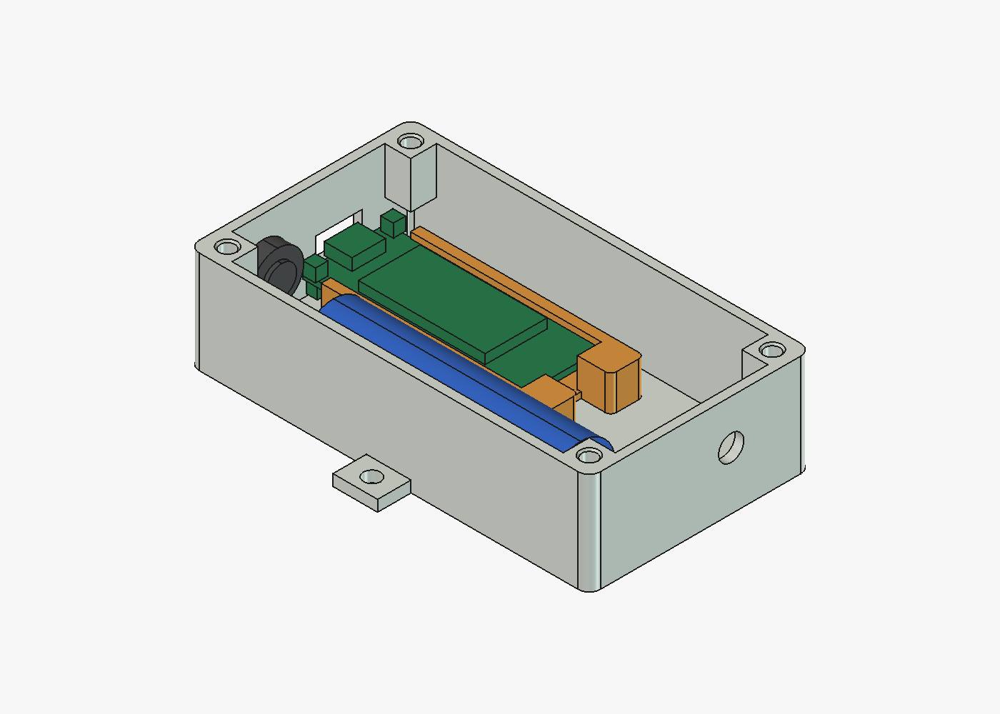

# Wide enclosure: Wireless Stick Lite V3 + 18650

English | [Português brasileiro](README.pt-BR.md)

**Current revision: `wide-r05`, physical test pending.**

Enclosure for a transmitter built on the Heltec Wireless Stick Lite V3, powered by one
protected 18650 cell, with the sensor on a cable. It is installed upright against a wall.
The USB-C opening and the cable gland face down, so splashes do not get in, and the antenna
faces up. Nothing goes through the back. The lid has no gasket, so use it under cover.



## Parts

| File | Part | On the bed |
| --- | --- | --- |
| [`body.stl`](print/body.stl) | Body, with columns, battery cradles and side mounting tabs | Back on the bed |
| [`lid.stl`](print/lid.stl) | Flat lid with an alignment lip and 2 posts that hold the carrier | Outer face on the bed (already flipped) |
| [`board-carrier.stl`](print/board-carrier.stl) | Wireless Stick Lite V3 carrier with rails and crossbars | Crossbars on the bed |
| [`usb-cover.stl`](print/usb-cover.stl) | USB-C opening cover | Flange on the bed (already flipped) |

The four files come oriented for printing and need no supports. Suggested settings: PETG,
0.2 mm layers, 4 walls, 100% scale. The SHA-256 of each file is in
[`revision.json`](revision.json).

## Hardware

- **Board.** One Heltec Wireless Stick Lite V3. For sensor wiring and firmware, see the
  [Stick Lite transmitter guide](https://github.com/cajui/cajui-firmware/blob/main/docs/stick-lite.md).
- **Battery.** One protected 18650 cell. The cradles are sized for 66.4 × Ø18.53 mm, measured
  on the cell used.
- **Inserts.** 4 M3 heat-set inserts, at the top of the body columns. The holes are Ø4.0 ×
  6.5 mm, with a chamfer to Ø5.0 mm at the mouth. They were sized for an M3 insert 5.7 mm long
  and Ø4.6 mm outside. Use an insert of Ø4.2 to 4.6 mm outside and up to 6 mm long; a Ø5 mm one
  displaces too much plastic in this hole.
- **Screws.** 4 M3×8 screws for the lid. The board carrier uses no screws.
- **Cable gland.** 1 M8×1.25 cable gland for 2 to 4 mm cable, on the bottom face.
- **Antenna.** 1 bulkhead SMA connector in the 6.8 mm hole on the top face, with an IPEX 1.0
  pigtail.

## Assembly

1. **Inserts.** Set them upright with a soldering iron:
   - rest the insert on the chamfer with its narrow end down;
   - let the heat do the work, without pushing;
   - check from the front and from the side during the first millimetre;
   - stop just short of the top and remove the iron;
   - while the plastic is still soft, press the insert flush with a flat piece of metal.
2. **Battery cable.** Plug it into the board connector and pass its adapter through the
   carrier, coming out between the two heads.
3. **Board.** Slide it into the rails, holding it by the edges, until it touches the heads.
   The cable runs underneath.
4. **Carrier.** Place it in the body with the USB-C facing the opening and drop the heads
   onto the two floor pins.
5. **Battery.** It sits in the cradles with the terminals up, towards the antenna end, and
   against the bottom stop. The sensor cable passes over the stop.
6. **Installation.** Mount the enclosure upright: USB-C and cable gland down, antenna up.
   The USB cover goes in with the pull tab facing the front of the enclosure.

## What to check on the first print

- The USB-C lines up with the opening and the cable plugs in fully (the connector height is
  an estimate).
- The board slides into the rails without force, and the rails do not spread when the
  carrier is held by the crossbars only.
- The USER button is not pressed, and the RST button does not touch the cable gland nut.
- The sensor cable bends between the cable gland and the battery stop without pushing the
  battery.
- The USB cover stays firmly in the opening and comes out by pulling the tab.
- The heads go onto the pins without force and without visible play, and the lid closes
  without pushing the carrier down.
- The battery seats in the cradles, and the lid closes without pressing on the battery or the
  wires.
- The inserts are firm, the columns do not crack, and the inserts sit centred: the screws pass
  through the lid without force.
- The cable gland and the SMA connector thread into the 2.4 mm wall.

## Known issues

- **Loose I²C adapter.** The I²C adapter of the sensor cable has no fixed place yet. It hangs
  from its wires, and on the r04 assembly one solder joint broke.
- **Workaround: double-sided tape.** Until a holder exists, the adapter can be fixed with
  acrylic foam double-sided tape on the metal shield of the board module. The shield is
  grounded, so first trim the solder joints flush and insulate the underside of the adapter.

## Revision history

To update an enclosure that was already printed, reprint only the parts that changed.

- **wide-r05 (2026-11-09).** 45° chamfer at the mouth of the four insert holes. On the r04
  print, inserts set with a soldering iron ended up off centre. Reprint only `body.stl`.
- **wide-r04.**
  - The enclosure is 10 mm longer at the bottom end, with a stop that keeps the battery from
    sliding onto the cable gland.
  - It is 2 mm taller, leaving 5.3 mm free above the battery for the cables.
  - The column next to the USER button only fills the upper half, with a 45° chamfer
    underneath. At full height it pressed the button.
  - New USB-C opening cover.
- **wide-r03.**
  - Screwless board carrier: it sits on two floor pins and is held by the lid posts.
  - Crossbars at the ends of the rails, with the middle left open.
  - Board 2 mm higher.
  - 8.6 mm between the heads for the battery cable adapter.
- **wide-r01 and wide-r02.** First layout. The r01 rails spread and released the board; r02
  joined them.

Revisions before r05 predate this repository, and their files are not kept here.

## Regenerate

From the repository root:

```sh
freecadcmd enclosures/wide/export.py   # STLs in print/ and verification.json
FreeCAD enclosures/wide/render.py      # print/preview.png; needs the FreeCAD GUI
```

On macOS, the two programs are `/Applications/FreeCAD.app/Contents/Resources/bin/freecadcmd`
and `/Applications/FreeCAD.app/Contents/MacOS/FreeCAD`. Tested with FreeCAD 1.1.4.

- **Model.** The parametric model is [`model.py`](model.py), with every dimension in the `P`
  dictionary.
- **Checks.** [`verification.json`](verification.json) records the mesh checks and the
  assembly collision check.
- **Revision.** [`revision.json`](revision.json) holds the revision, the hashes and the known
  limits.
