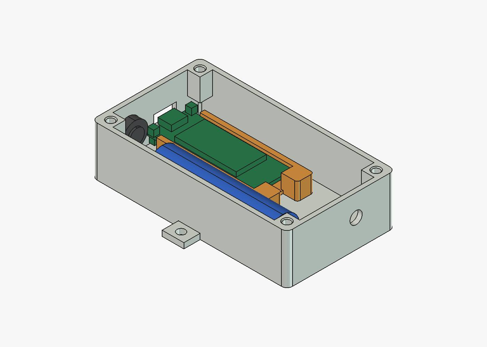

# Caixa ampla: Wireless Stick Lite V3 + 18650

[English](README.md) | Português brasileiro

**Revisão atual: `wide-r05`, ensaio físico pendente.**

Caixa para um transmissor montado na Heltec Wireless Stick Lite V3, alimentado por uma célula
18650 protegida, com o sensor num cabo. Ela é instalada em pé, contra uma parede. A abertura
do USB-C e o prensa-cabo ficam para baixo, para que respingos não entrem, e a antena fica para
cima. Nenhum furo atravessa o fundo. A tampa não tem junta, então use a caixa em local
coberto.



## Peças

| Arquivo | Peça | Na mesa |
| --- | --- | --- |
| [`body.stl`](print/body.stl) | Corpo, com colunas, berços da bateria e abas laterais de fixação | Fundo apoiado na mesa |
| [`lid.stl`](print/lid.stl) | Tampa lisa com lábio de encaixe e 2 pilares que prendem o suporte | Face externa na mesa (já vem virada) |
| [`board-carrier.stl`](print/board-carrier.stl) | Suporte da Wireless Stick Lite V3 com trilhos e travessas | Travessas apoiadas na mesa |
| [`usb-cover.stl`](print/usb-cover.stl) | Tampinha da abertura do USB-C | Aba na mesa (já vem virada) |

Os quatro arquivos já saem orientados para impressão e não precisam de suporte. Sugestão:
PETG, camada de 0,2 mm, 4 paredes, escala 100%. O SHA-256 de cada arquivo está no
[`revision.json`](revision.json).

## Ferragens

- **Placa.** Uma Heltec Wireless Stick Lite V3. Para a ligação do sensor e o firmware, veja o
  [guia do transmissor Stick Lite](https://github.com/cajui/cajui-firmware/blob/main/docs/stick-lite.md).
- **Bateria.** Uma célula 18650 protegida. Os berços foram dimensionados para 66,4 × Ø18,53 mm,
  medidos na célula usada.
- **Insertos.** 4 insertos M3 roscados a quente, no topo das colunas do corpo. Os furos têm
  Ø4,0 × 6,5 mm, com chanfro até Ø5,0 mm na boca. Foram calculados para um inserto M3 de
  5,7 mm de comprimento e Ø4,6 mm externo. Use um inserto de Ø4,2 a 4,6 mm externo e até 6 mm
  de comprimento; um de Ø5 mm desloca plástico demais nesse furo.
- **Parafusos.** 4 parafusos M3×8 na tampa. O suporte da placa não usa parafusos.
- **Prensa-cabo.** 1 prensa-cabo M8×1,25, para cabo de 2 a 4 mm, na face de baixo.
- **Antena.** 1 conector SMA de anteparo no furo de 6,8 mm da face de cima, com pigtail
  IPEX 1.0.

## Montagem

1. **Insertos.** Coloque-os na vertical, com o ferro de solda:
   - apoie o inserto no chanfro, com a ponta mais fina para baixo;
   - deixe o calor fazer o trabalho, sem forçar;
   - confira de frente e de lado no primeiro milímetro;
   - pare pouco antes do topo e tire o ferro;
   - com o plástico ainda mole, aperte o inserto com uma peça metálica plana até ficar rente.
2. **Cabo da bateria.** Ligue-o no conector da placa e passe o adaptador dele por dentro do
   suporte, saindo entre as duas cabeças.
3. **Placa.** Deslize-a nos trilhos, segurando pelas bordas, até encostar nas cabeças. O cabo
   corre por baixo dela.
4. **Suporte.** Coloque-o na caixa com o USB-C virado para a abertura e encaixe as cabeças nos
   dois pinos do piso.
5. **Bateria.** Ela entra nos berços com os terminais virados para cima, para o lado da
   antena, e encostada no batente de baixo. O cabo do sensor passa por cima do batente.
6. **Instalação.** Monte a caixa em pé: USB-C e prensa-cabo para baixo, antena para cima. A
   tampinha do USB-C entra com a lingueta virada para a frente da caixa.

## O que conferir na primeira impressão

- O USB-C alinha com a abertura e o cabo encaixa até o fim (a altura do conector é
  estimada).
- A placa desliza nos trilhos sem forçar, e os trilhos não abrem ao segurar o suporte só pelas
  travessas.
- O botão USER não fica pressionado, e o RST não encosta na porca do prensa-cabo.
- O cabo do sensor faz a curva entre o prensa-cabo e o batente sem empurrar a bateria.
- A tampinha do USB-C fica firme na abertura e sai puxando pela lingueta.
- As cabeças entram nos pinos sem forçar e sem folga visível, e a tampa fecha sem empurrar o
  suporte para baixo.
- A bateria assenta nos berços, e a tampa fecha sem pressionar a bateria ou os fios.
- Os insertos ficam firmes, sem trincar as colunas, e centrados: os parafusos passam pela tampa
  sem forçar.
- O prensa-cabo e o conector SMA rosqueiam na parede de 2,4 mm.

## Problemas conhecidos

- **Adaptador I²C solto.** O adaptador I²C do cabo do sensor ainda não tem lugar fixo. Ele fica
  pendurado pelos fios, e na montagem da r04 uma solda se soltou.
- **Solução provisória: fita dupla face.** Enquanto não houver um encaixe, o adaptador pode ser
  preso com fita dupla face de espuma acrílica sobre a blindagem metálica do módulo da placa.
  A blindagem é ligada ao terra, então antes corte as pontas da solda rente e isole a face de
  baixo do adaptador.

## Histórico de revisões

Para atualizar uma caixa já impressa, reimprima só as peças que mudaram.

- **wide-r05 (09/11/2026).** Chanfro de 45° na boca dos quatro furos dos insertos. Na
  impressão da r04, os insertos colocados com ferro de solda ficaram fora do centro.
  Reimprima só o `body.stl`.
- **wide-r04.**
  - A caixa ficou 10 mm mais comprida na ponta de baixo, com um batente que impede a bateria
    de escorregar até o prensa-cabo.
  - Ficou 2 mm mais alta, com 5,3 mm livres sobre a bateria para os cabos.
  - A coluna junto do botão USER ficou só na metade de cima, com chanfro de 45° por baixo.
    Inteira, ela deixava o botão pressionado.
  - Tampinha nova para a abertura do USB-C.
- **wide-r03.**
  - Suporte da placa sem parafusos: ele assenta em dois pinos do piso e é preso pelos pilares
    da tampa.
  - Travessas nas pontas dos trilhos, com o meio vazado.
  - Placa 2 mm mais alta.
  - 8,6 mm entre as cabeças para o adaptador do cabo da bateria.
- **wide-r01 e wide-r02.** Primeira disposição. Os trilhos da r01 abriam e soltavam a placa; a
  r02 passou a uni-los.

As revisões anteriores à r05 são de antes deste repositório, e os arquivos delas não ficam
aqui.

## Regerar

Na raiz do repositório:

```sh
freecadcmd enclosures/wide/export.py   # STLs em print/ e verification.json
FreeCAD enclosures/wide/render.py      # print/preview.png; precisa da interface do FreeCAD
```

No macOS, os dois programas ficam em
`/Applications/FreeCAD.app/Contents/Resources/bin/freecadcmd` e
`/Applications/FreeCAD.app/Contents/MacOS/FreeCAD`. Testado com o FreeCAD 1.1.4.

- **Modelo.** O modelo paramétrico é o [`model.py`](model.py), com todas as medidas no
  dicionário `P`.
- **Conferência.** O [`verification.json`](verification.json) registra a conferência das
  malhas e das colisões na montagem.
- **Revisão.** O [`revision.json`](revision.json) guarda a revisão, os hashes e os limites
  conhecidos.
